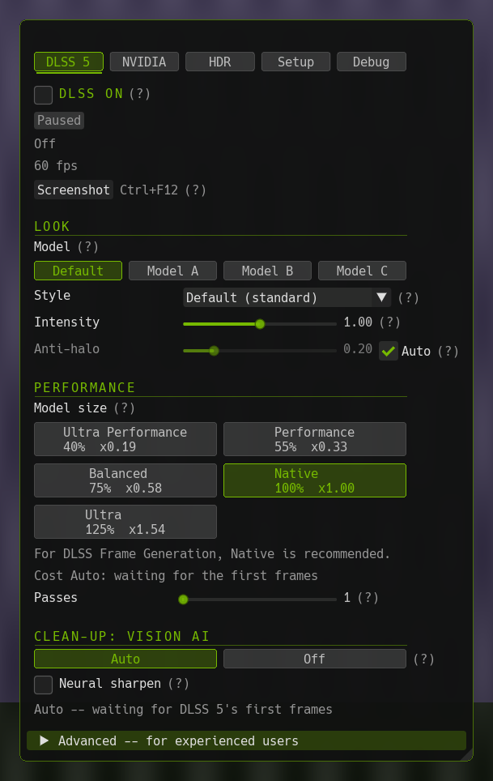
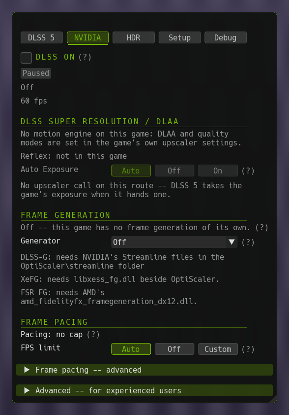
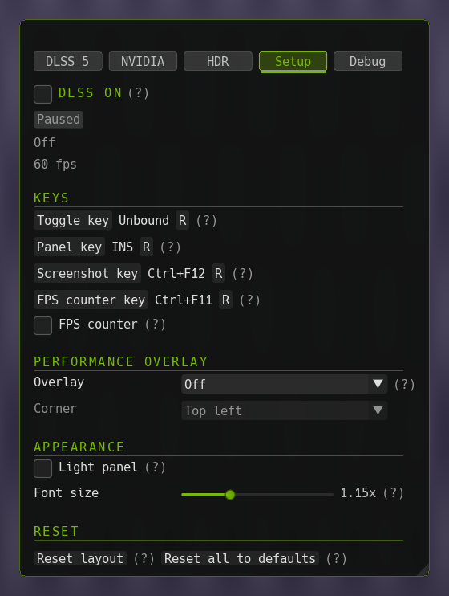
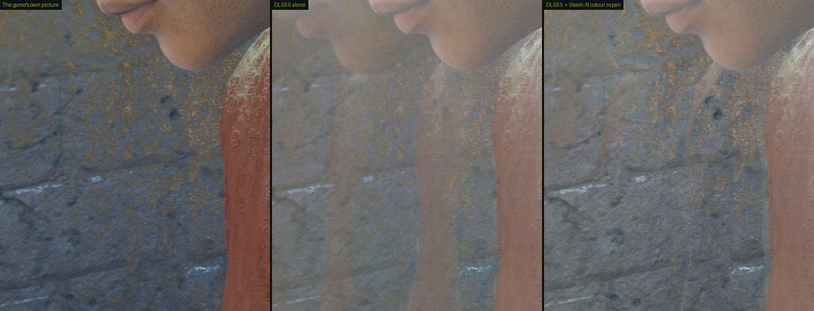
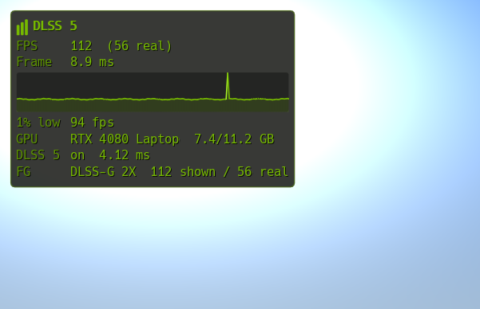
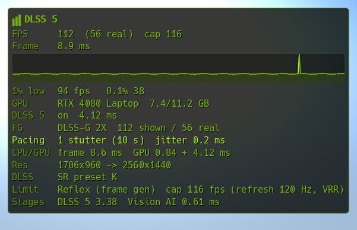

<!--
  README for the public mrcgibb9876-hash/OptiDLSS5-UI-releases repository (copy to its root as README.md).
  Image paths are relative to that repo: icon.png is already there; the screenshots in docs/screenshots/SHOTLIST.md
  must be copied to docs/screenshots/ in that repo too.
-->

  

<h1 align="center">OptiDLSS5-UI</h1>

<b>NVIDIA DLSS 5 Neural Rendering in your games. One click per game.</b> 
New games, old games, 32-bit games, games with no DLSS at all: the app works out the route, sets it up, and puts
everything back when you press Remove.

  
  
  

  
  
  

> [!NOTE]
> This page describes **v2.15**, which is in **beta** right now. Betas are a manual download from
> [Releases](https://github.com/mrcgibb9876-hash/OptiDLSS5-UI-releases/releases), because the built-in updater only offers
> stable builds. Stable stays on **v2.13.12** until v2.15 is final.

---

## What it does

OptiDLSS5-UI is a Windows app that puts NVIDIA's **DLSS 5 Neural Rendering** into your games. Scan your library, press
**Install** on a game, play. Behind that button is **OptiScaler_DLSSNR**, our own heavily extended engine built on
OptiScaler. The app picks the right way into each game: the game's own DLSS, the end of the frame, a 32-bit capture, a
Luma mod or the DLSS5 Feeder. It installs everything that route needs and records every file it touches, so **Remove**
leaves the folder exactly as it was. In the game, press **Insert** and every DLSS 5 control is right there, live, on
the frame you're looking at.

<!-- SCREENSHOT: main window with game cards (hero shot) -->
<!-- (screenshot coming soon) 

 -->

<!-- SCREENSHOT: before/after, same frame with DLSS 5 off and on -->
<!-- (screenshot coming soon) 

 -->

## ✨ Highlights

- **One click per game.** **Scan for Games** reads Steam's libraries on every drive, plus Epic and GOG. It picks the exe
  that actually renders, skipping launchers, crash reporters and anti-cheat wrappers.
- **DLSS 5 almost everywhere.** Games with DLSS, games without it, DirectX 8 to 12, Vulkan, 32-bit games and emulators
  are all covered. The card names the route, and you never have to choose one.
- **DLSS Frame Generation in more places.** That includes the Resident Evil games and other end-of-frame (Present route)
  games, and even **32-bit games** through our own 64-bit helper. Frame generation is always ready but **switched off at
  load**: you turn it on in the panel.
- **A real in-game panel, in the NVIDIA look.** Near-black with NVIDIA green, six tabs (DLSS 5, NVIDIA, HDR, Setup,
  Debug, OptiScaler) and 8 languages. Live model size, Vision AI, frame generation, frame pacing, built-in HDR, a
  screenshot key and an fps counter, every control with a one-line hint.
- **Vision AI, all on Auto.** One **Auto / Off** switch finishes DLSS 5's picture: it fixes black textures in HDR,
  repairs colours DLSS 5 shifted (in Oklab, so skin, sky and lights keep the game's own colour), stops the flash after a
  load or a camera cut, keeps faces and clothes in the game's colours, keeps the HUD sharp, and shows the game's own
  picture on menus, loading screens and cutscenes. A **self-check** backs itself off anywhere it would make things
  worse. **Neural sharpen** (off by default) adds crisper fine detail.
- **A performance overlay, built in.** FPS, frame time graph, 1% lows, GPU, VRAM and what each DLSS 5 stage costs, all
  in NVIDIA green. Four levels, any corner, **Ctrl + arrow keys** move it, and it steps out of the panel's way. No
  Afterburner or RTSS needed.
- **AI depth.** For games that hide their depth, a Depth Anything V2 model running on your GPU (DirectML) gives DLSS 5
  the depth it needs.
- **Built-in HDR and frame pacing.** The engine does HDR for SDR games and has its own pacing plus an FPS limiter. No
  add-ons needed.
- **Cleans up the picture before DLSS 5 sees it.** In supported games, motion blur, film grain, chromatic aberration,
  depth of field, lens flare and vignette are switched off in the game's own settings. Every original value is
  recorded, and Remove puts each one back.
- **Keeps NVIDIA's DLSS current.** The Super Resolution, Ray Reconstruction and Frame Generation DLLs a game ships are
  updated to NVIDIA's newest public build. The originals are kept, and Remove puts them back.
- **Autopilot.** After you play, it reads the engine's log. If DLSS 5 didn't run, it gets the next route ready for your
  next launch. It never starts a game by itself, and every change can be undone.
- **Game Help.** It reads the game's logs and tells you what to do in a few plain steps, usually with a one-click
  **Fix it**.
- **Repair game.** One list of what other mods, tools and Windows settings changed for a game, with safe fixes and an
  **Undo** on the card. Nothing is deleted.

### 🆕 New in v2.15

- **NVIDIA DLSS Frame Generation in Resident Evil 2 / 3 / 4 / 7 / Village, Devil May Cry 5 and Street Fighter 6**, and
  in the other Present-route games, on RTX 40/50. It was tested in RE4 and RE2.
- **32-bit games use the engine's own capture.** DirectX 8/9 games (via dgVoodoo2 or DXVK) and 32-bit DirectX 11 games
  no longer need the DLSS5 Feeder or ReShade. They get real motion (NVIDIA optical flow), and **DLSS Frame Generation**
  on RTX 40/50.
- **64-bit Vulkan games with no upscaler** run DLSS 5 natively at the end of the frame.
- **Built-in HDR and the engine's own frame pacing + FPS limiter** replace RenoDX and ReLimiter.
- **DLSS 5 at full size by default** (Native 100%), plus an Ultra Performance 40% option when you need the frames.
- **Frame generation always starts off**, on every route. Auto prepares the best generator, and you switch it on.
- **GPU scheduling, sorted.** DLSS-G needs Windows' GPU scheduling, so if it's off the app offers to turn it on. If DLSS-G
  is refused, the game no longer closes: it falls back to another generator instead.
- **Autopilot**, **DLSS DLL updates** and **Game picture effects** are new in v2.15 too.

### 🆕 New in v2.15.0-beta.4

- **A cleaner Vision AI picture.** Black textures in HDR are fixed. Colours DLSS 5 shifted are repaired from the
  game's own (Oklab colour repair). No more flash after a load or a camera cut. **Character protection** keeps faces and
  clothes in the game's colours. A **self-check** looks at every frame and backs Vision AI off wherever it would make
  things worse. **HUD protection** keeps the HUD crisp, and Vision AI knows a menu, loading screen or cutscene when it
  sees one and leaves it as the game drew it. All of it is Auto, nothing to set.
- **Neural sharpen.** Crisper fine detail from a small neural sharpener over DLSS 5's finished picture
  (Barbatos Neural Sharpening, MIT). Off by default: one checkbox under DLSS 5 > Clean-up: Vision AI.
- **The performance overlay.** Off / Basic / Normal / Full in any corner, all green, moved with **Ctrl + arrow keys**.
  It moves away from the panel while it's open and never shows in screenshots. No Afterburner or RTSS needed.
- **The NVIDIA look and six tabs.** The in-game panel and the app's pop-out are near-black with NVIDIA green, with the
  tabs **DLSS 5 · NVIDIA · HDR · Setup · Debug · OptiScaler** (more under "The in-game panel" below).
- **DLSS Frame Generation on Vulkan.** 64-bit Vulkan games on the Present route get NVIDIA DLSS-G on RTX 40/50.
- **DirectX 11 games on the engine's Present route, with DLSS-G.** 64-bit DX11 games without DLSS move off the DLSS5
  Feeder onto the engine's own route, with DLSS-G on RTX 40/50. It was tested on Prey.
- **A 64-bit capture helper**, bringing DLSS 5 and DLSS-G to 64-bit DirectX 9 and OpenGL games, the same way 32-bit
  games already get it.
- **A trail guard behind moving characters** and a **HUD guard**, built into Vision AI Auto.
- **Frame generation on RTX 20 / 30.** NVIDIA DLSS-G needs an RTX 40/50, so Auto prepares AMD's FSR 3 frame generation
  there instead. Like every generator, it starts switched off.
- **Clean slate before Install, and Repair game.** Other mods that would stop the game (a SweetFX `dxgi.dll`, for
  example) are moved aside, never deleted. Restore and Remove put them back. **Repair game** on the card lists what
  other installers, tools and Windows settings changed for a game, fixes it safely, and keeps an **Undo**.
- **Get help with this game.** Known problems are fixed first, then one click makes a report zip for the developer.

## 🤔 Why not just OptiScaler?

[OptiScaler](https://github.com/optiscaler/OptiScaler) is brilliant, and it's the foundation all of this stands on.
OptiScaler_DLSSNR starts there and keeps going. Measured on 2026-10-06 (engine v2.3.0-beta.4, app v2.15.0-beta.4)
against upstream OptiScaler `master`:

|  | OptiScaler_DLSSNR (engine) | OptiDLSS5-UI (app) |
|---|---|---|
| Commits of our own | **653**, on top of OptiScaler | **770** |
| Lines of our own code | **~178,000** (~263,000 counting bundled third-party code) | **~75,000** JS/HTML/CSS, plus **~18,700** lines of translations |
| Files | **~630 new**, and 118 of OptiScaler's changed | **130** test files |

For scale, **OptiScaler's own code is about 127,000 lines.** The DLSS 5 work on top is bigger than the whole upstream
project.

Here's roughly where the engine's additions live:

- **~111,000 lines** in the DLSS 5 / neural rendering core: the DLSS 5 route, Vision AI, the in-game panel and its 7
  translations, the performance overlay, AI depth, optical flow and the Present route.
- **~35,000 lines** of shaders.
- **~26,000 lines** in nrcore, the shared neural rendering pipeline.
- **~27,000 lines** in the 32-bit and 64-bit capture and the 64-bit helper.
- **~10,000 lines** of frame generation and hooks.

OptiScaler swaps upscalers. This project sets up **DLSS 5 Neural Rendering** per game, through whatever route that game
needs. It adds its own panel, AI, HDR, pacing and 32-bit bridge, and an app that installs, checks, fixes and cleanly
removes all of it.

## 🎮 Supported games and routes

Each game's card names its route. **You don't pick it.** The app does.

| Your game | Route | What happens |
|---|---|---|
| Ships its own DLSS (Cyberpunk 2077, The Witcher 3, Stellar Blade...) | **OptiScaler** | DLSS 5 goes on top of the game's own DLSS, so turn DLSS on in the game's settings. On RTX 40/50, Auto prepares DLSS Frame Generation where the game has none of its own. |
| DirectX 11 game that ships DLSS | **OptiScaler, DX11** | Uses the game's own D3D11 DLSS, or the engine's DX11-to-DX12 bridge, which also allows frame generation. *Experimental.* |
| Resident Evil 2 / 3 / 4 / 7 / Village, DMC5, SF6, Elden Ring, Armored Core VI, Nightreign, and 64-bit DX12 games with no upscaler | **Present route** | DLSS 5 runs at the end of each frame and finds the scene depth by itself. Nothing extra to download, and no REFramework. DLSS-G on RTX 40/50 is new in v2.15. |
| 64-bit Vulkan game with no upscaler | **Present route (Vulkan)** | DLSS 5 runs natively on Vulkan, with no Feeder and no ReShade layer. DLSS-G on RTX 40/50 is new in beta.4. |
| Games with a [Luma-Framework](https://github.com/Filoppi/Luma-Framework) DLSS mod (Monster Hunter: World, Prey, Fallen Order...) | **Luma** | The mod adds real DLSS with the game's own motion vectors, and DLSS 5 goes on top. It's set up on DirectX 11, and the game list comes from Luma's own releases. |
| 32-bit DirectX 8 / 9 / 11 games (Max Payne 2, Castlevania: Lords of Shadow...) | **Engine capture + 64-bit helper** | Each frame goes to a 64-bit helper where DLSS 5 runs, with NVIDIA optical-flow motion. On RTX 40/50, DLSS-G is shown over the game. No ReShade. Run the game borderless or windowed. *Experimental.* |
| 64-bit DirectX 11 game with no upscaler (Prey...) | **Present route (DX11)** | The game's frames go through the engine's DX11-to-DX12 bridge, and DLSS 5 runs at the end of each frame. DLSS-G on RTX 40/50. New in beta.4. *Experimental.* |
| 64-bit DirectX 9 and OpenGL games | **Engine capture + 64-bit helper** | The same capture as the 32-bit games, in a 64-bit build: DLSS 5 and, on RTX 40/50, DLSS-G shown over the game. Run the game borderless or windowed. New in beta.4. *Experimental.* |
| DX10, 32-bit OpenGL, 32-bit DX12, emulators, and games the routes above cannot take | **DLSS5 Feeder** | The [DLSS5 Feeder](https://github.com/jlrouzies-fr/DLSS5-Feeder) builds a DLSS call from ReShade's depth and estimated motion vectors. Old DX9 games go through dgVoodoo2 or DXVK. *Experimental for emulators and DX9.* |

Games that offer both DX12 and DX11 are set up for DX12. A ✓ on a card means someone confirmed that route end to end
on a real install.

### Add-ons you no longer need

- **REFramework** on Present-route Resident Evil / RE Engine games. A copy the app placed earlier goes to a backup
  folder instead of being deleted.
- **RenoDX.** The engine's built-in HDR replaces it (turn the game's own HDR off). A RenoDX you installed yourself is
  left alone.
- **ReLimiter.** The engine's own frame pacing and FPS limiter replace it.
- **ReShade + DLSS5 Feeder on 32-bit DX8/9/11 games.** The engine's own capture replaces them. Your old Feeder files
  are backed up, and **Back to the DLSS5 Feeder...** on the card restores them file for file.

## 🚀 Quick start

1. **Download** `OptiDLSS5-UI-Setup-<version>.exe` from
   [Releases](https://github.com/mrcgibb9876-hash/OptiDLSS5-UI-releases/releases). The `Portable` exe also works, with
   nothing to install. The installer isn't code-signed yet, so if Windows says *"Windows protected your PC"*, click
   **More info > Run anyway**.
2. Click **Scan for Games**, tick the games you want and click **Add**. Or use **+ Add Game** and point it at an exe.
3. Press **Install** on a card. The engine and everything the route needs go in. On first launch, the app fetches the
   Neural Rendering model (~165 MB).
4. **Launch** the game, get into actual gameplay, and press **Insert** for the DLSS 5 panel. When you quit, the card
   shows what the run did.
5. Something not right? Press **Game Help** on the card.

## 🎛️ The in-game panel

| Key | What it does |
|---|---|
| `Insert` | Opens and closes the DLSS 5 panel. On Resident Evil / RE Engine games with REFramework in the folder, the key is `Alt+Home`. |
| `Esc` | Closes the panel. |
| `Ctrl+F12` | Takes a screenshot. |
| `Ctrl+F11` | Shows or hides the fps counter. |
| `Ctrl` + arrow keys | Moves the performance overlay to another corner. |
| `Home` | Opens ReShade, on Feeder-route games only. |
| `Backspace` | Opens the RTXMFG menu, where you installed it. |

You can rebind the panel's keys on its **Setup** tab. The panel wears the **NVIDIA look** (near-black, NVIDIA green;
a light panel is one tick away in Setup > Appearance) and has six tabs:

- **DLSS 5.** Everything DLSS 5 on one page. **Look:** Model, Style, Intensity and, right under it, Anti-halo.
  **Performance:** Model size (40 / 55 / 75 / 100 / 125%, each with its live cost) and Passes; each extra pass has its
  own Model, Style and Intensity under it. **Clean-up: Vision AI:** Auto / Off, **Neural sharpen**, and a short line for
  what Vision AI is doing right now (colour repair, character protection, self-check, HUD and scene guard).
- **NVIDIA.** DLSS Super Resolution / DLAA, the **Frame Generation** box and **Generator** picker (Off / Auto /
  DLSS-G / XeFG / FSR FG), Reflex, and **Frame pacing** with the FPS limit.
- **HDR.** The **built-in HDR**, which stays off on Auto in games that have their own HDR.
- **Setup.** Keys, appearance, font size, the **performance overlay**, and the two Reset buttons.
- **Debug.** The tools for reporting a problem.
- **OptiScaler.** OptiScaler's own menu, as a tab.

Coming from an older version? The old Main / Tuning / Image / Pacing pages are folded into these tabs. Nothing was
removed: rarely used settings sit under **Advanced** on the tab they belong to. The panel follows the language you pick
in the app.

  
  &nbsp;
  

### Vision AI

DLSS 5 makes a great picture, and Vision AI makes sure it's still the game's picture. Here's an Uncharted crop: the
game's own frame, DLSS 5 alone (washed-out colour on the wall and the shirt), and DLSS 5 with Vision AI's colour repair.

<!-- SCREENSHOT: a real in-game before/after, full frame (SHOTLIST.md #2) -->

### The performance overlay

**Setup > Performance overlay**: Off, Basic, Normal or Full, in any corner. It shows FPS (and real frames when frame
generation is on), a frame-time graph, 1% lows, GPU and VRAM, what DLSS 5 and Vision AI cost, and on Full the frame
pacing, the render resolution and the active limiter. Ctrl + arrow keys move it while you play, it steps aside while
the panel is open, and it never ends up in screenshots or in what DLSS 5 sees.

  
  &nbsp;
  

### The pop-out

Some games won't draw an overlay, and a 32-bit game can only mirror the helper's panel. For those, the app opens **its
own copy of the panel** in an always-on-top window over the game, with the same controls in the same order. It writes
straight to the game's settings, and the engine picks the change up within a second. Settings can give the pop-out a
key of its own.

<!-- SCREENSHOT: pop-out panel over a 32-bit game -->
<!-- (screenshot coming soon) 

 -->

> [!TIP]
> Run games **borderless or windowed**. Windows won't draw the panel, the pop-out or a 32-bit game's DLSS-G window over
> exclusive fullscreen.

## ⚡ Frame generation

**Frame generation always starts switched OFF when a game loads, on every route.** Auto (or the generator you picked in
Edit) gets the best one ready, and you switch it on with the **Frame Generation** box in the panel or the pop-out.

| Your setup | What you get |
|---|---|
| **RTX 40 / 50** | **NVIDIA DLSS Frame Generation** first, wherever it can run. On RTX 40, [RTXMFG](https://github.com/dashdogy/RTX40MFG-Unlock) can unlock 3x-6x in games that ship DLSS-G (experimental on RTX 30). |
| **RTX 20 / 30** | DLSS-G needs an RTX 40 or newer, so these cards use the **FSR 3 frame generation fallback**. |
| **Games on the Feeder route** | [Lossless Scaling](https://store.steampowered.com/app/993090/Lossless_Scaling/) (a separate paid app) can be set up per game and toggled from the panel. |

DLSS-G needs Windows' **Hardware-accelerated GPU scheduling**. If it's off, the app asks once and turns it on for you.
It takes effect after a restart, and nothing changes until you click.

## 🛡️ Safety first

- **Remove really removes.** The app records every file it adds, and Remove puts the folder back as it was. Updated
  DLSS DLLs go back to the game's originals, and picture settings go back key by key.
- **Backups, not deletes.** Old Feeder installs move to `.dlss5ui-feeder-backup\`, and an REFramework the app placed
  moves to a backup folder.
- **Never someone else's file.** The app won't overwrite a `dinput8.dll` / `dinput.dll` it didn't put there (an ASI
  loader, for example), and it never downgrades a DLSS DLL.
- **Hands off a running game.** Game settings files and DLSS DLLs are never changed while the game is open.
- **Frame generation off at load.** And if a game ever loses its GPU with frame generation armed, frame generation
  stays off in that game from then on, until you pick a generator again.
- **Keep as is.** Put an empty `.dlss5ui-keep-as-is` file beside a game's exe, and sync won't update or change that
  game's setup. Install, Edit and Remove still work when you press them.
- **Anti-cheat games** are started without their anti-cheat, so play them **offline only** and press **Remove** before
  going online. Online-only games stay in your list but are never synced.

## ❓ FAQ and troubleshooting

**Nothing happens when I press Insert.**
Run the game borderless or windowed. On a Resident Evil game with REFramework in its folder, try `Alt+Home`. On a 32-bit
game, the pop-out takes over. **Game Help** on the card tells you which applies.

**DLSS 5 doesn't seem to do anything.**
On a game with its own DLSS, turn DLSS on in the game's graphics settings. Play a minute of real gameplay (not just the
menu), quit, and open **Game Help**. It reads the logs and names the problem: a driver that's too old, no depth, another
DLSS 5 tool in the folder, and so on.

<!-- SCREENSHOT: Game Help with a Fix it button -->
<!-- (screenshot coming soon) 

 -->

**Frame generation isn't on.**
That's by design: it starts off. Tick **Frame Generation** in the panel. If DLSS-G is greyed out, the panel says why
(GPU scheduling is off, the card is older than RTX 40, or files are missing).

**My fps dropped.**
DLSS 5 runs at Native 100% by default, which looks best and costs the most. Pick a smaller **Model size** on the
panel's DLSS 5 tab (Performance), such as Balanced 75% or Performance 55%. The performance overlay shows what each
step costs.

**Windows Defender flagged `nrhost64.exe` or `dinput8.dll`.**
Older builds were flagged as "Bearfoos.A!ml", which was a false positive, and the current files scan clean. If yours is
caught anyway, restore it from **Windows Security > Protection history**.

**It still doesn't work.**
When DLSS 5 didn't run, the card offers **Report issue** (in Autopilot, it's **Send game failure**). It shows you
exactly what will be sent, signs you in to GitHub once, and files an issue here with your logs attached. You can also
[open an issue](https://github.com/mrcgibb9876-hash/OptiDLSS5-UI-releases/issues/new) by hand, or ask in the
[Discord](https://discord.gg/HFZTDdSNmJ) **#help** channel: post the game, your GPU and what Game Help said.

<!-- SCREENSHOT: Autopilot dialog -->
<!-- (screenshot coming soon) 

 -->

## 💻 System requirements

- **Windows 10 or 11**, 64-bit.
- **An NVIDIA GeForce RTX card, 20 to 50 series.** This app is **NVIDIA RTX only**.
- **NVIDIA driver 616.56 or newer.** The app tells you when yours is older.
- **For DLSS Frame Generation:** an RTX 40 or 50 card, with Hardware-accelerated GPU scheduling on.
- An internet connection on first launch, for the model and the cover art.

## ☕ Support the project

OptiDLSS5-UI is a **one-person project**, built around a full-time job, a family and a three-month-old baby. If it
brought a favourite game to life for you, a coffee genuinely helps keep the late nights going. If not, a bug report, a
result posted on the Discord or a kind word helps just as much. Thank you for playing with it. ❤️

  
  &nbsp;
  

## 🙏 Credits and licences

**The app is closed source: OptiDLSS5-UI is proprietary, all rights reserved.** **The OptiScaler_DLSSNR engine it
installs is a fork of [OptiScaler](https://github.com/optiscaler/OptiScaler) and stays GPL-3.0.** Every engine release
on [OptiScaler_DLSSNR-releases](https://github.com/mrcgibb9876-hash/OptiScaler_DLSSNR-releases/releases) carries its
complete source as `OptiScaler_DLSSNR-<tag>-source.zip`. The app's `LICENSE.txt` and `THIRD-PARTY-NOTICES.md` ship
with it, in its install folder. NVIDIA's `nvngx_dlssnr.dll` is NVIDIA's own, and this project does not redistribute
it.

None of this would exist without other people's brilliant work. Thank you all.

**The engine is built on, or learned from:**

| Project | What it gives us | Licence |
|---|---|---|
| [OptiScaler](https://github.com/optiscaler/OptiScaler) (cdozdil and contributors) | The upstream engine everything is built on | GPL-3.0 |
| [DXL](https://github.com/LCPD15/DXL) (LCPD15) | The design of the Present route and its depth tracker | AGPL-3.0 (attribution in the engine's `Licenses` folder) |
| [RenoDX](https://github.com/clshortfuse/renodx) (clshortfuse) | The colour composition in the DLSS 5 shader | Attribution in the engine's `Licenses` folder |
| [DLSS5-Feeder](https://github.com/jlrouzies-fr/DLSS5-Feeder) (Jean-Laurent Rouzies) | The protocol the 32-bit helper builds on, and the Feeder route | MIT |
| dlss5-dx11-bridge (NIGos) | Part of what the 32-bit helper builds on | MIT |
| [NVIDIA Streamline](https://developer.nvidia.com/rtx/streamline), DLSS SDK, NVAPI, Optical Flow SDK | DLSS, DLSS Frame Generation, Reflex and optical-flow motion | NVIDIA licences |
| [AMD FidelityFX SDK](https://github.com/GPUOpen-LibrariesAndSDKs/FidelityFX-SDK) | FSR frame generation and FidelityFX optical flow | MIT |
| [Intel XeSS](https://github.com/intel/xess) | XeSS and XeFG | Intel licence |
| [Depth Anything V2](https://github.com/DepthAnything/Depth-Anything-V2) (Yang et al.) | The AI depth model | Apache-2.0 |
| [Barbatos Neural Sharpening](https://github.com/BarbatosBachiko/Reshade-Shaders) (BaBa_Sharpen_Neural, Barbatos Bachiko) | Neural sharpen: its Model A network, ported to compute shaders | MIT |
| [potatoFX](https://github.com/GimleLarpes/potatoFX) (GimleLarpes), Oklab by Björn Ottosson | The Oklab colour maths in Vision AI's colour repair | MIT |
| [ONNX Runtime](https://github.com/microsoft/onnxruntime) + DirectML (Microsoft) | Running AI depth on your GPU | MIT |
| xBR-lv2 (Hyllian) | The xBR upsampler | MIT |
| [Dear ImGui](https://github.com/ocornut/imgui), [ReShade](https://github.com/crosire/reshade) add-on headers, [spdlog](https://github.com/gabime/spdlog), [simpleini](https://github.com/brofield/simpleini), [magic_enum](https://github.com/Neargye/magic_enum), [unordered_dense](https://github.com/martinus/unordered_dense), nlohmann/json, FreeType, Detours, DirectX Agility SDK, Vulkan-Headers, AntiLag 2 SDK, LatencyFleX | The panel, logging, settings and the plumbing | Each under its own licence, see the engine source |

**The app fetches or works with these**, always from their own official releases and checksum-checked where they publish
sums:

| Project | Used for | Licence |
|---|---|---|
| [ReShade](https://reshade.me) (crosire) + [reshade-shaders](https://github.com/crosire/reshade-shaders) | The host for the Feeder route | BSD 3-Clause |
| [vort_Shaders](https://github.com/vortigern11/vort_Shaders) (vortigern11) | Default motion vectors for the Feeder | MIT |
| [LumeniteFX](https://github.com/umar-afzaal/LumeniteFX) (umar-afzaal) | Optional Feeder motion vectors, after you accept its licence | AGNYA |
| [iMMERSE](https://github.com/martymcmodding/iMMERSE) (Marty's Mods) | Used only if you already have it; never downloaded | All rights reserved |
| [RHI](https://github.com/RankFTW/RHI) (RankFTW) | The manifest for Streamline, DLSS, DLSS-G and the NR model | GPL-3.0 |
| ShortFuse's `nvngx_dlssnr.dll` 310.8.SF build (via RHI) | Neural Rendering on RTX 20/30/40 | Modified NVIDIA DLL |
| [Luma-Framework](https://github.com/Filoppi/Luma-Framework) (Filoppi) | DLSS mods for the Luma route, after you accept its licence | Custom MIT variant |
| [REFramework](https://github.com/praydog/REFramework) (praydog) | RE Engine games that still need it | MIT |
| [dgVoodoo2](https://github.com/dege-diosg/dgVoodoo2) (Dege) | DirectX 8/9 to 11 for old games, after asking you | Freeware |
| [DXVK](https://github.com/doitsujin/dxvk) | DirectX 8/9/11 over Vulkan for old games | zlib |
| [RTXMFG](https://github.com/dashdogy/RTX40MFG-Unlock) (dashdogy) | Multi Frame Generation on RTX 40 (experimentally RTX 30) | MIT |
| [Windows-Game-Patches](https://github.com/illusionyy/Windows-Game-Patches) (illusionyy) + [Ultimate ASI Loader](https://github.com/ThirteenAG/Ultimate-ASI-Loader) (ThirteenAG) | Switching off Uncharted: Legacy of Thieves' forced post effects | MIT |
| [Lossless Scaling](https://store.steampowered.com/app/993090/Lossless_Scaling/) (THS) | Frame generation for Feeder games; configured, never installed | Paid (Steam) |
| [SteamGridDB](https://www.steamgriddb.com/) | Cover art for the game cards | Its own terms |
| [DLSS5-Swapper](https://github.com/rakanki911/DLSS5-Swapper) (Rakan Alkhaldi) | `src/library.js`, the original install core, the emulator table and the 32-bit helper layout | MIT |
| [DLSS5-Autopilot](https://github.com/Kizzuwatnaa/DLSS5-Autopilot) (Kizzuwatnaa) | The ideas behind Autopilot (no code copied) and the emulator detection table | MIT |
| ReLimiter (RankFTW), RenoDX, PureDark's Upscaler Base Plugin | Earlier routes, now replaced. Old copies are still recognised so they can be cleaned up | Their own |

And thank you to every tester on the Discord. The Dying Light, ENSLAVED, Resident Evil 4 and many other reports are why
this release works the way it does.

*NVIDIA, GeForce RTX and DLSS are trademarks of NVIDIA Corporation. This project is not affiliated with or endorsed by
NVIDIA, or by any project listed above.*

---

<a href="https://discord.gg/HFZTDdSNmJ"><b>Join the OptiDLSS5-UI Discord</b></a> · <a href="https://buymeacoffee.com/ripplingsnake"><b>Buy me a coffee</b></a>

